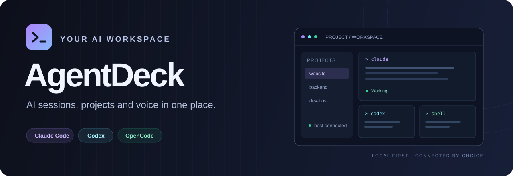
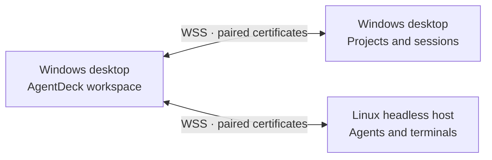
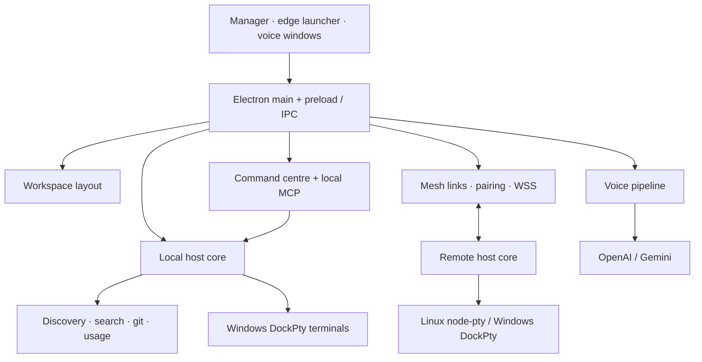

<div align="center">



<br>

**Your projects. Your agents. Your whole development fleet.**

A Windows desktop workspace for **Claude Code**, **Codex CLI** and **OpenCode** — with persistent terminals, voice tools and direct connections to your other machines.

[](#installation)
[](LICENSE)
[](#architecture)
[](#privacy-and-security)

[](https://github.com/MitrevStudio/-AgentDeck/actions/workflows/ci.yml)
[](https://github.com/MitrevStudio/-AgentDeck/actions/workflows/release.yml)
[](https://github.com/MitrevStudio/-AgentDeck/releases/latest)

<br>

[**Download for Windows**](https://github.com/MitrevStudio/-AgentDeck/releases/latest) · [**Get started**](#your-first-five-minutes) · [**Explore features**](#feature-tour) · [**Report an issue**](https://github.com/MitrevStudio/-AgentDeck/issues)

</div>

---

## Meet AgentDeck

Working with several coding agents quickly becomes a navigation problem: which terminal belongs to which repository, what a session was doing yesterday, which agent needs your attention, and where the work is actually running.

AgentDeck brings those pieces into one desktop workspace. Choose a project, start an agent, split a terminal beside it, find an earlier conversation, or resume a session on a paired Linux host. A small handle at the top of your screen keeps the launcher within reach while you work in another app.

Voice is part of that workflow too. Dictate a prompt into the active application, clean up what you said, edit selected text with a spoken instruction, listen to a response, or ask the command centre to start work in a project.

> [!NOTE]
> AgentDeck uses the coding CLIs installed on your machines. Install and sign in to the agents you want to use separately. Voice features use your own provider API keys; the command centre uses Claude Code.

## At a glance

| 🗂️ Projects & sessions | 🖥️ Terminals & workspace | 🎙️ Voice & control |
| --- | --- | --- |
| Claude Code, Codex CLI and OpenCode | Built-in terminal tabs | Dictation into other applications |
| Automatic local session discovery | Horizontal and vertical splits | Verbatim, Clean and Prompt modes |
| Pinned projects and custom groups | Drag tabs and panes to rearrange | Spoken edits to selected text |
| Search, previews and session resume | Persistent Windows terminal processes | Read aloud and quick voice questions |
| Git branch and working-tree status | Remote terminals over the mesh | Claude-powered command centre |

| 📊 Visibility | 🌐 Connected machines | ⚙️ Everyday polish |
| --- | --- | --- |
| Token usage and estimated API cost | Desktop-to-desktop connections | English and Bulgarian interface |
| Claude and Codex plan limits | Linux headless host | Dark, light and system themes |
| Context and session cost indicators | Pairing with certificate pinning | Global shortcuts and keyboard help |
| CPU, memory and disk readings | Clone repositories onto another host | Tray operation and Windows startup |
| Optional daily activity report | Host setup and agent readiness checks | Automatic installed-app updates |

## Contents

- [Installation](#installation)
- [Your first five minutes](#your-first-five-minutes)
- [Feature tour](#feature-tour)
- [Connected machines and remote work](#connected-machines-and-remote-work)
- [Linux headless host](#linux-headless-host)
- [Keyboard shortcuts](#keyboard-shortcuts)
- [Settings and customization](#settings-and-customization)
- [Updates](#updates)
- [Privacy and security](#privacy-and-security)
- [Data and storage](#data-and-storage)
- [Development](#development)
- [Architecture](#architecture)
- [Troubleshooting](#troubleshooting)
- [Current boundaries](#current-boundaries)
- [Contributing](#contributing)
- [License](#license)

## Installation

### Windows installer

1. Open [GitHub Releases](https://github.com/MitrevStudio/-AgentDeck/releases/latest).
2. Download `AgentDeck-Setup-<version>.exe`.
3. Run the installer and choose the installation directory.
4. Launch AgentDeck from the desktop or Start menu shortcut.

The installer targets **Windows x64**, installs for the current user and lets you change the destination. A separate Node.js installation is needed for development from source, rather than for the packaged desktop app itself.

The installer is currently unsigned. If Windows SmartScreen shows a warning, verify that you downloaded it from this repository's Releases page before choosing **More info → Run anyway**.

### Linux AppImage (experimental)

1. Open [GitHub Releases](https://github.com/MitrevStudio/-AgentDeck/releases/latest).
2. Download `AgentDeck-<version>.AppImage`.
3. Make it executable and run it:

```bash
chmod +x AgentDeck-*.AppImage
./AgentDeck-*.AppImage --ozone-platform=wayland   # leave the flag out under X11
```

The AppImage targets **Linux x64** and is tested on Wayland under Hyprland. It does not update itself: download the new AppImage from Releases. Start it from a shell, or from a launcher whose environment has the agents (`claude`, `codex`, `opencode`) on `PATH`. Voice tools need Hyprland, `wtype` and `wl-clipboard`; see [Linux desktop](#linux-desktop-experimental) for what differs from Windows.

### Supported agent versions

AgentDeck supports **only the latest stable releases** of **Claude Code**, **Codex CLI**, and **OpenCode 2.x**. Keep the agents up to date on every connected machine. Older releases and OpenCode 1.x are not supported; we do not maintain legacy storage readers or API compatibility fallbacks.

OpenCode integration uses the v2 `session_v2` and `session_message` SQLite tables and the v2 `model.list` API. Upgrade and let OpenCode migrate its own data before using AgentDeck. Legacy tables left behind by migration are ignored; AgentDeck never migrates or writes to the agent's database.

Context indicators show the last reported context separately from accumulated usage and cost. Claude Code launches from AgentDeck collect status-line metadata while preserving the existing display command; Codex uses its last token-usage report; OpenCode 2 reads its main-session messages and current configured model limits. Approximate limits are marked with `≈`, and compaction or a model change can temporarily show “awaiting update”. Historical sessions do not necessarily have a recorded context limit. A cache is marked warm only when the agent reports it.

Local verification baseline (2026-11-09): Claude Code **2.1.282**, Codex CLI **0.163.0**, OpenCode **2.2.6**. These are tested versions, not permanent version pins or a promise of support for older releases.

Run `npm run test:context` to check context accounting, compaction, subagent isolation, status-line preservation, model limits, and OpenCode 2 session discovery. Existing Claude terminals need to be resumed through AgentDeck to receive the status-line collector; transcript-based estimates remain available meanwhile.

### Other requirements

| Component | Needed for |
| --- | --- |
| Windows 10/11, x64 | The desktop application and Windows integrations |
| Linux x64 (experimental) | The desktop application as an AppImage; Wayland/Hyprland is the tested setup |
| Hyprland, `wtype`, `wl-clipboard` | Voice tools on Linux |
| Installed, authenticated coding CLI | Starting and resuming that agent's sessions |
| Windows Terminal (`wt.exe`) | External Windows Terminal mode |
| Git on the relevant machine | Repository status, branches and clone workflows |
| Microphone and a provider API key | Dictation and other voice input features |
| Gemini API key | Gemini read-aloud generation |
| Claude Code | The command centre and generated daily summaries |

Built-in **AgentDeck tabs** are the default terminal destination. Windows Terminal is an alternative you can select in settings or the tray menu.

<details>
<summary><strong>Run from source instead</strong></summary>

Use Windows, Git, npm and **Node.js 24**, matching the repository's CI setup.

```powershell
git clone https://github.com/MitrevStudio/-AgentDeck.git
cd ./-AgentDeck
npm ci
npm start
```

There is no separate frontend build step for development: Electron loads the application from `src/`.

For an isolated development profile:

```powershell
$env:AGENTDECK_USER_DATA = Join-Path $PWD ".dev-profile"
npm start
```

The profile has its own settings, registry and single-instance lock. Source runs do not use installed-app automatic updates or the packaged Windows startup integration.

</details>

## Your first five minutes

1. **Choose your language and theme.** Open Settings and select English if needed; the initial defaults are Bulgarian and dark mode.
2. **Check your agents.** Ensure the CLI you want is on `PATH` and already signed in. You can use one agent or all three.
3. **Add a project folder.** Use the **+** beside Projects. Existing session folders can also populate the catalog through discovery.
4. **Start a session.** Select the project and choose Claude, Codex or OpenCode. It opens in a terminal tab by default.
5. **Try a second pane.** Open a shell or another agent beside the current terminal, then resize the divider.
6. **Find earlier work.** Press <kbd>Ctrl</kbd> + <kbd>K</kbd>, type a project name or phrase from a conversation, and inspect the preview.
7. **Add voice when you want it.** Configure your provider key and microphone, then press <kbd>Ctrl</kbd> + <kbd>Space</kbd> to dictate.

> [!TIP]
> Press <kbd>F1</kbd> in the manager to see its shortcuts. The edge menu has its own keyboard-help panel showing the currently registered global shortcuts.

## Feature tour

### Projects and session discovery

The sidebar is a catalog of the repositories and folders you work in. Add directories, rename their display names, pin frequent projects, organize groups and reorder items with drag and drop. Clicking a project shows the list of its sessions, with the state of the running ones; its open tabs stay in the tab strip. In that list the eye on a row hides a session (it leaves search and the edge menu too; **N hidden - show** brings the hidden ones back, dimmed, to unhide), and the filter above it keeps the list to the last week, the last month or a number of days of your own, remembered per project. Running sessions are always listed. Projects on your other computers hide and filter the same way. Drag the lines between **Projects**, **Agents** and **Terminals** (or move them with ↑/↓) to resize the sections; a double-click resets a line.

AgentDeck combines sessions from three sources:

| Agent | Discovery | Resume command |
| --- | --- | --- |
| **Claude Code** | Local transcripts under `~/.claude/projects/` | `claude --resume <id>` |
| **Codex CLI** | Local rollouts under `~/.codex/sessions/` | `codex resume <id>` |
| **OpenCode 2** | Read-only v2 database for sessions, previews and usage; v2 API for model limits | `opencode --session <id>` |

The catalog refreshes as local session files change. AgentDeck derives titles and project associations from the metadata it can read, including a session's current working directory when it changes into a worktree.

The Agents list makes running sessions easier to find, with live states where the integration can determine them. A session waiting for you is different from one still working; notifications can bring you back when attention is needed.

Removing a project from the catalog and deleting a session are separate actions. Discovery and previews read history; explicit session deletion can remove the corresponding agent history.

### A terminal workspace for every project

Each project has its own workspace, with tabs containing one or more terminal panes. Keep an implementation agent, a second agent and a regular shell together without losing their project context.

- Split panes **right** or **down** and resize their dividers.
- Move between panes with directional shortcuts.
- Zoom the focused pane and return to the full arrangement.
- Rename and reorder tabs. A renamed one-pane tab of a Claude session on this computer also names the session, as `/rename` does, so the name shows in the agents list, on the session cards and in `claude --resume`.
- Drag pane headers to move terminals; drag tabs onto panes to combine their layouts. A tab held over while dragging comes up to take the drop.
- Drag a row from **Agents** or **Terminals** onto a pane to open that terminal on that side of it (or onto the tab strip for a tab of its own), from any of your computers. Drag a pane or a tab onto the sidebar to hide it; the terminal keeps running.
- Detach a pane into its own tab.
- Change terminal text size and overall interface scale independently.
- Paste clipboard images or drop files into terminals through the application's file handling.

On Windows, terminals run through **DockPty**, the repository's native pseudoconsole bridge. Terminal processes can survive quitting AgentDeck: reopening the app reattaches to still-running terminals and restores their layout and retained output.

Use the tray's **Stop all terminals and quit** action when you intend to end those processes too. Closing an individual terminal pane ends that terminal.

If you prefer external terminals, select **Windows Terminal** as the destination and choose whether launches use a new window or a tab in an existing one. AgentDeck can bring a matching running terminal forward; eligible sessions can also be moved into its own workspace.

<details>
<summary><strong>Long sessions: automatic remember and compact</strong></summary>

For large Claude Code sessions in AgentDeck tabs, automatic compaction can issue `/remember:remember`, followed by `/compact`, after a completed turn and a quiet period.

It is **off by default**. Switch it on and pick a threshold (**100k, 150k, 200k, 300k or 500k tokens**) in **Settings → Terminal**; the recommended threshold follows your Claude plan (Max: 300k, otherwise 150k). A threshold you had already chosen stays on after the update.

The workflow watches for intervening user input and avoids repeatedly compacting until the context falls below the threshold. The remember step depends on that command being available in your Claude Code setup.

</details>

### Search and conversation previews

The <kbd>Ctrl</kbd> + <kbd>K</kbd> palette searches project and session metadata: names, titles, folders and session IDs. Local Claude and Codex transcripts also have a full-text index, so you can find a conversation by what was said.

Select a result to see its preview alongside the list. Depending on the agent and available history, it includes:

- The first prompt and recent prompts and replies.
- The model, start time and most recent activity.
- Counts of prompts, replies and subagents.
- Context or cost indicators where available.

Previews focus on the conversation and omit tool output and internal bookkeeping. Large transcript files are read incrementally or from the end; background workers handle indexing.

Press <kbd>Enter</kbd> to bring a running session forward or resume a stopped one. Use <kbd>Alt</kbd> + <kbd>Enter</kbd> to resume beside the focused pane. Supported Claude sessions also offer **Continue fresh**, starting a new conversation with a handoff from the previous one.

Remote session metadata joins the shared list and palette. Full-text transcript indexing and detailed previews currently operate on the local host.

### The top-edge launcher

A small translucent handle sits at the top of the screen. Hover briefly to reveal the menu, or click to keep it open with search focused. Move the handle along the edge; its position is remembered.

The launcher gives you quick access to projects, recent sessions, running agents, git information and voice controls without first opening the full manager. It also opens from the tray or its global shortcut, usually <kbd>Alt</kbd> + <kbd>`</kbd>.

Hover-opened menus retract when you leave. The handle hides while a fullscreen application is active, and you can disable it while retaining shortcut and tray access.

### Voice tools

Voice tools work across applications through global shortcuts, a recording overlay, provider transcription and delivery back to the target window. Configure **OpenAI** or **Gemini** with your own API key, choose a microphone and set your language and recording preferences.

#### Dictate into the active application

Press <kbd>Ctrl</kbd> + <kbd>Space</kbd> to record. The overlay shows a waveform and timer. Finish with the shortcut again, or use push-to-talk: hold while speaking and release to finish.

The default **Tap or hold** behavior supports both patterns. Choose tap-only or hold-only if preferred. Press <kbd>Esc</kbd> during recording to cancel.

AgentDeck tries to deliver the result to the application that was in front when recording began. If it cannot bring that window back, it leaves the result in the clipboard for manual pasting. Recordings started from the tray deliver to the clipboard.

| Mode | Result | Useful for |
| --- | --- | --- |
| **Verbatim** | The recognized text | Keeping your original phrasing |
| **Clean** | Removes fillers, repetitions and false starts while preserving meaning | Messages, notes and prose |
| **Prompt** | Turns free speech into a clearer coding-agent prompt | Describing a task aloud |

Clean and Prompt make an additional text-model request using your configured provider. Prompt output can follow the spoken language or use English. If rewriting fails, dictation falls back to the recognized text; History retains original and rewritten versions where applicable.

#### Teach it your vocabulary

The dictionary supports **terms** to guide recognition and rewriting, plus **replacements** for recurring mistakes. Project names can contribute vocabulary too.

Use it for repository names, products, libraries, abbreviations and technical words you mix into another language. Replacements match whole words without depending on letter case.

#### Edit selected text by voice

Select text in an application and use <kbd>Ctrl</kbd> + <kbd>Alt</kbd> + <kbd>Space</kbd>, then speak an instruction:

> “Translate this into English.”
>
> “Make this shorter and keep the technical details.”

AgentDeck sends the selected text and your instruction to the configured text provider and replaces the selection with the result. If processing fails, the delivery workflow restores the original selection text.

#### Ask a quick question

Use <kbd>Ctrl</kbd> + <kbd>Shift</kbd> + <kbd>/</kbd> to ask a short question by voice. The answer appears in a small popup and is copied to the clipboard, making short commands or snippets convenient to paste.

This uses the configured provider's text model. It is a quick-answer workflow without a browsing tool.

#### Read selected text aloud

Select text and press <kbd>Ctrl</kbd> + <kbd>Shift</kbd> + <kbd>Space</kbd>. Gemini generates the speech; the playback panel offers pause, stop and speed controls. Speed adjustment preserves voice pitch, and the selection-copy workflow restores the previous clipboard contents.

Press the shortcut again to stop playback. Configure the read-aloud model and voice separately from dictation.

#### History and recovery

Failed recordings remain available for retry. The overlay shows the error, the tray marks pending failures, and you can retry one recording or retry/discard the failed queue from the tray.

History keeps recordings and results, including original recognition when rewriting changed the text. Audio and text have separate retention limits; see [Data and storage](#data-and-storage).

### The command centre

The command centre is an AgentDeck-managed **Claude Code session** with its own terminal and conversation history. It receives typed requests or transcribed voice commands and uses AgentDeck's tools through a local **Model Context Protocol (MCP)** server.

For example:

> “Start Codex in the website project and ask it to add tests for the login form.”
>
> “Ask the backend project what changed in the authentication flow and tell me the result.”
>
> “Show me the session about the logs.”

It can list local projects and sessions, start an agent on a prompt, send a message to a session in an AgentDeck tab, wait for an answer, read recent conversation messages and show a project or running session.

To speak a command, hold the edge-menu shortcut and release when finished, or use the menu's microphone button. The transcript goes to the command centre; Commands settings let you disable this or restrict the trigger to the microphone button.

The centre resumes its own conversation on later starts. Its tools coordinate sessions rather than providing a general shell or file API. Current orchestration targets local projects; paired-machine terminal control is available through the regular interface.

> [!IMPORTANT]
> Voice commands are actionable requests sent to the command centre. Review work in the visible agent terminals and use each CLI's permission controls.

### Usage, limits and machine resources

The Usage view separates **how many tokens sessions consumed** from **how much a subscription allows**.

**Token and cost reporting** includes today, the last 7 days, the last 30 days and all time. Explore a daily cost/token chart and the projects, sessions and models behind the totals. Smaller chips show costs in session lists and project context.

Costs are **API-equivalent estimates** using the application's price table in [`src/host/usage-prices.js`](src/host/usage-prices.js). They are a comparison metric, not an invoice: subscription plans do not charge you those per-token amounts. Unknown model prices produce token counts without a cost estimate.

**Plan limits** are shown separately for installed Claude Code and Codex CLIs, with provider-reported usage windows, reset times and forecasts where available. Codex uses its local app-server account RPC; API-key sign-in may not provide ChatGPT subscription limits.

**Machine resources** show whole-computer CPU, memory and home-volume disk readings. Paired hosts publish resource, usage and limit information over their direct connection as well.

**On the taskbar** (Windows): a small strip beside the tray icons can show this computer's network traffic (up/down), CPU and memory, updated every second; 90% and above turns red, and the tooltip adds today's traffic total. It is **off by default**, with nothing chosen: switch it on and pick what it shows in **Settings → General → Taskbar**. Clicks pass through it to the taskbar, and it steps aside for full-screen apps.

### Git awareness and daily activity

Git indicators show a project's branch, staged/modified/untracked counts, conflicts and commits ahead of or behind its upstream. They appear in relevant project and session views, including the edge launcher.

Status inspection is read-only and avoids optional Git locks. Automatic refresh never fetches, so ahead/behind numbers reflect the most recent fetch. Use the Git panel's repository actions to fetch explicitly, stage files, review and commit, manage branches, or create a worktree for an AI task.

The optional **Day** view in the edge menu groups Claude Code activity by ticket key, or by project when no ticket is found. It estimates active time from message timestamps and merges overlapping activity so parallel sessions do not count the same wall-clock minutes twice.

Browse earlier days and request a short work-log summary through `claude -p`. These durations are heuristics derived from conversations rather than a running time tracker; generating a summary sends the selected activity digest through Claude Code.

## Connected machines and remote work

AgentDeck's **mesh** connects desktops and headless hosts directly over your LAN or VPN. There is no central AgentDeck cloud service or broker to deploy.



### Pair two computers

1. Open **Settings → Computers** on the machines you want to connect.
2. Give each a recognizable name and check its listening port. The default is **7421**.
3. Enable local-network visibility if you want mDNS discovery.
4. Find the other machine, enter the pairing code shown there and connect.
5. If discovery is unavailable, add it by hostname or IP address, including `:port` for a non-default port.

Windows Firewall may prompt when the app first listens. Allow the connection on the private network you intend to use. Discovery uses mDNS; manually adding an address is useful over VPNs or network segments that do not pass multicast.

### Work on another machine

Paired projects appear in the shared project list with their machine identity. Remote sessions join the Agents list and metadata search.

Select a remote project to open a shell, start one of the host's agents or resume a recent session. The process runs **there** while its terminal pane appears **here**, with streamed output, keyboard input and resizing.

Remote panes remain in your saved layout. If a host goes offline, the pane reports that state; reconnecting reattaches to the host's available terminal.

### One terminal, open everywhere

A terminal belongs to the computer it runs on, whoever started it. Any of your paired devices can open it at the same time — another desktop, the phone, the computer's own window — see where it is and type into it; the pane header shows who else has it open.

- **X hides the pane.** The terminal keeps running and stays listed under **Agents** or **Terminals** in the sidebar, on every device.
- **Stop** (the red button in the pane header, with a confirmation) ends it for everyone.
- **One size.** Whoever typed last sets the terminal's size; the others show it at that size and can take it with **Use my size**.
- Opening a session that is already running attaches to its terminal instead of resuming it a second time.
- After a restart the computer reopens its terminals, so the panes on your other devices find them again.

Sessions that run outside an AgentDeck terminal (for example in Windows Terminal) cannot be shared this way; **Move here** brings one in. See [docs/SHARED-SESSIONS.md](docs/SHARED-SESSIONS.md).

### AgentDeck on your phone (Android)

The Android app shows the sessions of all your computers in one list — the ones waiting for you on top — lets you reply, start and stop sessions, and opens any terminal. It connects to **your own relay** by address and port: no account, no cloud service, no push provider.

1. Install `AgentDeck-<version>.apk` from the [latest release](https://github.com/MitrevStudio/-AgentDeck/releases/latest) (Android asks to allow installing from your browser or file manager).
2. On a desktop open **Settings → Computers → Phones → Add phone**, tick the computers the phone should reach and check the relay address as the phone will reach it.
3. In the app choose **Scan** and point it at the code — or paste the text shown under it. One code pairs the phone with the relay and every ticked computer; it is valid for ten minutes and works once.

Without a desktop at hand, enter the relay's address and its pairing code in the app, then pair each computer behind it with that computer's own code — the same as pairing two desktops. **Forget** on the phone's row in Settings removes it from the relay and from your other computers too.

The phone needs a relay it can reach (see [Relay in Docker](#relay-in-docker)); the link is encrypted end to end between the phone and each computer, so the relay cannot read it. There are no notifications: the app shows what is waiting while it is open. See [docs/MOBILE.md](docs/MOBILE.md).

### Clone a project onto a host

Choose **Clone to…** from a local project's menu or context menu, then select:

- The paired destination computer.
- A target folder, defaulting to a location such as `~/work/<name>`.
- An existing branch, or a new branch based on a selected base.
- Optionally, an agent and a starting task.

Cloning, branch selection and optional agent launch run in a remote terminal visible in your workspace. Once the clone creates the repository, its folder joins that host's project catalog.

For SSH remotes, configure the destination host's key and trusted Git host first. The dialog also offers HTTPS conversion for supported SSH-style repository addresses.

### Prepare a remote host

The paired computer's **Setup** panel checks Git, SSH keys, trusted hosts, Git identity and agent availability. It can generate a key on the host, display its public key, add a Git host to `known_hosts` and set Git name/email.

Install and authenticate agents on the host itself, using a remote terminal for interactive login. Its private SSH key stays on that machine.

> [!IMPORTANT]
> Pairing grants meaningful control: a paired computer or phone can launch terminals and sessions on the host and type into the ones running there. Pair only your own devices, and keep a desktop's mesh port off the public internet — the port meant to be reachable from outside is the relay's.

## Linux headless host

Use a Linux machine as an agent host while keeping the Windows desktop as your interface. The host package runs the same session and terminal core without Electron or a graphical desktop.

### Install

Prerequisites: **Git, npm, Node.js 20+ and a systemd user-service environment**. Use **Node.js 24** for a setup consistent with desktop CI and SQLite-dependent features. On Node 20, transcript full-text search is unavailable.

```bash
curl -fsSL https://raw.githubusercontent.com/MitrevStudio/-AgentDeck/main/host/install.sh | bash
```

The installer checks out the host-related directories into `~/.agentdeck/app`, installs host dependencies, creates and starts the `agentdeck-host` systemd user service, and prints the pairing code and address. It attempts to enable lingering so the service can continue after logout; that step may request sudo.

If `node-pty` cannot load, the installer reports missing build prerequisites. On Debian/Ubuntu, these can include `build-essential` and `python3`.

### Relay in Docker

A relay only routes mesh traffic between your paired computers: the tunnels are end-to-end TLS, so it can neither read nor act on what it carries, and it runs no agents. It ships as an image for `amd64` and `arm64`, published with every release:

```bash
docker run -d --name agentdeck-relay --hostname agentdeck-relay --restart unless-stopped \
  -p 7421:7421 -v agentdeck-relay:/data ghcr.io/mitrevstudio/agentdeck-relay:latest

# Its pairing code: 26 letters and digits, XXXX-XXXX-...-XX (it changes after each pairing)
docker exec agentdeck-relay agentdeck-host pair
```

Or with [`host/docker-compose.yml`](host/docker-compose.yml): `docker compose up -d`, then `docker compose exec relay agentdeck-host pair`.

- Keep the `/data` volume: it holds the relay's identity, pairing code and paired computers. Without it every new container is a different relay that must be paired again.
- The hostname is the name your computers see for the relay.
- A relay's (and any host's) pairing code is long - 128 random bits - so it cannot be guessed even when the port is open to the internet; a desktop's is six digits. The code itself is never sent: both computers prove they know it, tied to the two computers' certificates, so neither a computer that merely answers at that address nor one sitting between them can pair or learn the code, and what it saw cannot be used to search for the code afterwards. Pairing therefore needs this version or newer on both computers (existing pairings keep working). Every node allows one code per connection and makes the next try from the same address (an IPv6 /64 counts as one) wait longer after each wrong code (up to 5 minutes); a desktop also stops pairing for a minute after 10 wrong codes from anywhere. Wrong tries show under **Settings → Computers** and in the log. `--pair-token` needs at least 20 letters or digits (not a few repeated); a weaker one is ignored with a warning and the host keeps its own long code.
- To reach it from outside your network, forward a TCP port on your router to the server's port `7421`, and allow only the source addresses you need where you can. On each computer, pair under **Settings → Computers** with your public address or DDNS name, plus `:port` when the external port is not 7421.
- The container runs with `--no-discovery`, because mDNS does not leave a container network. Computers reach the relay by its address.
- Build it yourself from the repository root: `docker build -f host/Dockerfile -t agentdeck-relay .`

The image is relay-only. Running agents on a machine (`--with-api`) needs the agents, their sign-in and `node-pty`, so use the installer below for a resource host.

### Manage the service

```bash
# Check the host
node ~/.agentdeck/app/host/bin/agentdeck-host.js status

# Show its pairing code
node ~/.agentdeck/app/host/bin/agentdeck-host.js pair

# View logs
node ~/.agentdeck/app/host/bin/agentdeck-host.js logs

# Pull updates, install dependencies and restart
node ~/.agentdeck/app/host/bin/agentdeck-host.js update

# Remove the service
node ~/.agentdeck/app/host/bin/agentdeck-host.js uninstall
```

Data and logs live under `~/.agentdeck/host/`. Agents and their authentication belong to the user running the service. Ensure executables are visible in the service's `PATH`, not just an interactive shell's configuration.

<details>
<summary><strong>Advanced host options</strong></summary>

Run a host manually:

```bash
node host/bin/agentdeck-host.js run --name dev-host --port 7421
```

Supported run options include `--data-dir`, `--port`, `--name`, `--pair-token`, `--no-discovery` and `--interface`; `agentdeck-host.js --help` lists every command and option (an unknown one is refused).

Installer variables include `AGENTDECK_BRANCH`, `AGENTDECK_REPO`, `AGENTDECK_APP` and `AGENTDECK_DATA`. The installer manages its checkout and can reset it to the selected remote branch when rerun; keep personal code changes in a separate checkout.

The same host entry point can run on Windows, but the Linux installer and systemd setup do not apply there. Windows headless operation has no dedicated installer/service integration.

The mesh design notes and implementation history are in [`docs/MESH.md`](docs/MESH.md). That document also contains planning material; use the current code and this README for user-facing behavior.

</details>

## Keyboard shortcuts

### Global voice and launcher controls

| Shortcut | Action |
| --- | --- |
| <kbd>Alt</kbd> + <kbd>`</kbd> | Open the edge launcher; hold to speak a command when enabled |
| <kbd>Ctrl</kbd> + <kbd>Space</kbd> | Dictate: tap to toggle, or hold/release in the default mode |
| <kbd>Ctrl</kbd> + <kbd>Shift</kbd> + <kbd>Space</kbd> | Read selected text aloud; press again to stop |
| <kbd>Ctrl</kbd> + <kbd>Alt</kbd> + <kbd>Space</kbd> | Edit selected text with a spoken instruction |
| <kbd>Ctrl</kbd> + <kbd>Shift</kbd> + <kbd>/</kbd> | Ask a quick question by voice |
| <kbd>Esc</kbd> | Cancel an active recording |

The launcher tries the first available shortcut from `Alt+Backtick`, `Ctrl+Alt+Space` and `Ctrl+Alt+Shift+Space`. Check the tray/menu for the actual registered combination; a fallback can conflict with another global voice shortcut. Keyboard help reports the current bindings.

### Manager and workspace

| Shortcut | Action |
| --- | --- |
| <kbd>Ctrl</kbd> + <kbd>K</kbd> | Search projects and sessions |
| <kbd>Ctrl</kbd> + <kbd>Shift</kbd> + <kbd>T</kbd> | New shell terminal |
| <kbd>Ctrl</kbd> + <kbd>Shift</kbd> + <kbd>1</kbd> | New Claude session |
| <kbd>Ctrl</kbd> + <kbd>Shift</kbd> + <kbd>2</kbd> | New Codex session |
| <kbd>Ctrl</kbd> + <kbd>Shift</kbd> + <kbd>3</kbd> | New OpenCode session |
| Add <kbd>Alt</kbd> to an agent shortcut | Open the new agent beside the focused pane |
| <kbd>Ctrl</kbd> + <kbd>Shift</kbd> + <kbd>R</kbd> | Resume the latest session |
| <kbd>Alt</kbd> + <kbd>Shift</kbd> + <kbd>=</kbd> / <kbd>-</kbd> | Split right / down |
| <kbd>Alt</kbd> + arrow keys | Focus a neighboring pane |
| <kbd>Ctrl</kbd> + <kbd>Tab</kbd> / <kbd>Ctrl</kbd> + <kbd>Shift</kbd> + <kbd>Tab</kbd> | Next / previous tab |
| <kbd>Ctrl</kbd> + <kbd>Shift</kbd> + <kbd>Z</kbd> | Toggle pane zoom |
| <kbd>Ctrl</kbd> + <kbd>Shift</kbd> + <kbd>W</kbd> | Close the focused pane |
| <kbd>Ctrl</kbd> + <kbd>=</kbd> / <kbd>-</kbd> / <kbd>0</kbd> | Increase / decrease / reset terminal font size |
| <kbd>Ctrl</kbd> + <kbd>,</kbd> | Settings |
| <kbd>Ctrl</kbd> + <kbd>Shift</kbd> + <kbd>H</kbd> | Voice history |
| <kbd>Ctrl</kbd> + <kbd>Shift</kbd> + <kbd>U</kbd> | Usage view |
| <kbd>F5</kbd> | Rescan |
| <kbd>F1</kbd> | Keyboard help |

Agent-launch shortcuts require the corresponding CLI. In the search palette, arrows select results, Enter opens, Alt+Enter opens beside the current pane, and Esc closes.

## Settings and customization

| Area | What you can change |
| --- | --- |
| **General** | English/Bulgarian, colour theme, window scale, notifications, the taskbar strip, startup and updates |
| **Terminal** | Built-in tabs or Windows Terminal, external window behavior, font size and automatic compaction |
| **Source control** | The editor the Git screens open a changed file in: VS Code or IntelliJ IDEA |
| **Dictation** | Provider, model, language, microphone, recording length, delivery, text mode and push-to-talk |
| **Dictionary** | Recognition terms, replacement rules and project vocabulary |
| **Read aloud** | Gemini model, voice and playback speed |
| **Commands** | Enable/disable spoken commands and choose their trigger |
| **Network** | System/PAC/manual/direct proxy modes, credentials and connection testing |
| **Computers** | Node identity, discovery, pairing, peers and host setup |

**Themes:** System (follows Windows), Dark, Light and Black (true black for OLED screens), plus sixteen adapted from popular VS Code themes: One Dark Pro, Dracula, GitHub Dark, Tokyo Night, Catppuccin Mocha, Night Owl, Nord, Ayu Mirage, Gruvbox Dark and Solarized Dark, and the light One Light, Tokyo Night Light, Light Owl, Ayu Light, Catppuccin Latte and Solarized Light. A theme recolours every window and the built-in terminals at once. The VS Code themes are MIT licensed; their authors and licences are listed in [THIRD_PARTY_NOTICES.md](THIRD_PARTY_NOTICES.md).

The tray also provides quick language/theme switches, terminal destination controls, voice actions and app lifecycle controls. Closing the manager leaves AgentDeck available in the tray.

**Start with Windows** applies to installed copies and starts quietly in the tray. It is enabled once for a new installed setup; disabling it persists.

<details>
<summary><strong>Proxy and corporate-network support</strong></summary>

Provider requests and update checks use Electron's Chromium network stack, following Windows trust and proxy configuration.

- **System:** Windows proxy configuration, including PAC/WPAD.
- **PAC:** An explicit proxy configuration URL.
- **Manual:** A proxy URL and bypass rules; HTTP, HTTPS and SOCKS5 forms are supported.
- **Direct:** Connect without a proxy.

Optional credentials support authenticated proxies; saved passwords use encrypted storage. The connection test reports the selected route and timing or failure reason.

An optional setting passes proxy information to newly launched agent terminals through `HTTP_PROXY`, `HTTPS_PROXY`, `NO_PROXY` and `NODE_USE_ENV_PROXY=1`. This is off by default; individual CLIs remain responsible for how they interpret those variables.

</details>

## Updates

Installed copies check GitHub Releases shortly after startup and then every four hours. With automatic updating enabled, AgentDeck downloads an available release in the background and installs it when you quit.

Once a download is ready, use **Restart and update** from Settings or the tray to apply it immediately. Settings also exposes the current version, update status and a manual check.

Turning automatic updates off keeps checks and notifications available while making download an explicit action. Network failures or temporarily incomplete release availability are retried later.

Automatic updates apply to installed builds. Source runs and unpacked development builds do not use the installed-app updater.

## Privacy and security

AgentDeck keeps its project catalog, layout, indexes and voice history on the machine. Local discovery, git status and previews do not require an AgentDeck account or hosted AgentDeck backend.

Some features intentionally communicate beyond the local app:

| Feature | Data flow |
| --- | --- |
| Coding sessions | The selected CLI communicates using its own configuration and account |
| Dictation | Audio and relevant recognition context go to the selected provider |
| Clean / Prompt | Recognized text and rewrite context go to the text provider |
| Voice editing | Selected text and spoken instruction go to the provider |
| Voice questions | The question and relevant vocabulary go to the provider |
| Read aloud | Selected text goes to Gemini for speech generation |
| Command centre | Requests and tool results enter its Claude Code conversation |
| Generated day summaries | An activity digest is passed to Claude Code |
| Updates | The app contacts the release service |
| Mesh | Paired machines exchange metadata, status and requested terminal/file data |

API keys and proxy passwords use Electron `safeStorage` encryption on Windows. Key saving fails when encryption is unavailable rather than falling back to plaintext. This does **not** encrypt all local history: voice text, audio, session indexes and logs should be treated as local user data.

Mesh trust is established through pairing and pinned certificate fingerprints over TLS. mDNS finds a machine; it does not grant trust. Forgetting a peer tears down the pairing connection. Treat a paired host as a trusted machine with execution access.

The command centre's MCP service binds to `127.0.0.1` and requires a bearer token. Agent launchers validate agent/session arguments; session titles are display data rather than shell commands. These controls complement the agents' own permission settings.

## Data and storage

Fresh desktop profiles normally live at:

```text
%APPDATA%\AgentDeck
```

The active profile contains the encryption context associated with its `Local State` file. Preserve that context when backing up your data.

| Location inside the profile | Purpose |
| --- | --- |
| `settings.json` | UI, terminal, network and voice preferences; encrypted secrets |
| `registry.json` | Project catalog, groups and organization |
| `workspace.json` | Saved spaces, tabs and pane arrangements |
| `terminals/` | Metadata for reconnecting to Windows terminal processes |
| `search.db` | Local transcript full-text index |
| `usage-cache.json` | Cached usage calculations |
| `taskbar-traffic.json` | Today's network traffic total for the taskbar strip |
| `voice/records/` | Audio files and per-record JSON metadata |
| `node/` | Mesh identity and pairing state |
| `orchestrator/` | Command-centre instructions, MCP configuration and state |

Voice retention keeps audio for **14 days**, with a **1 GiB** audio cap, and record metadata/text for **90 days**, up to **500 records**. Failed jobs are not removed by the normal age timer; a separate cap retains up to **50** failures.

For backups, preserve the entire profile and its encryption context. Copying `settings.json` alone does not guarantee that another Windows account or machine can decrypt its secrets. Coding agents' original histories remain in their own directories.

## Development

### Local workflow

```powershell
npm ci
npm start
```

The desktop uses Electron, plain JavaScript, HTML and CSS. Windows integration uses Koffi and the C# DockPty bridge. Linux host terminals use `node-pty` from the separate `host/` package.

### Checks

```powershell
# Syntax-check JavaScript under src/
npm run check

# Focused regression checks used by CI
node scripts/test-remote-state.js
node scripts/test-resources.js
node scripts/test-codex-live.js
node scripts/test-project-sessions.js
npm run test:limits
npm run test:themes
npm run test:editors
```

Additional focused checks live in `scripts/`, including workspace and mesh tests. Inspect a script's prerequisites before running integration checks; some need runtime capabilities beyond syntax checking.

### Package for Windows

```powershell
# NSIS installer
npm run dist

# Unpacked application
npm run dist:dir
```

Outputs are written under `dist/`. The installer is `AgentDeck-Setup-<version>.exe`; the unpacked executable is `dist/win-unpacked/AgentDeck.exe`. Build configuration lives in `package.json`.

### Linux desktop (experimental)

The desktop also runs on Linux x64 (tested on Wayland/Hyprland). Terminals use `node-pty`, built for Electron's ABI:

```bash
npm ci
npm run setup:linux   # downloads Electron and rebuilds node-pty for it
npm start             # add --ozone-platform=wayland on Wayland
npm run dist:linux    # AppImage and dist/linux-unpacked/
```

Pushes and pull requests check and package it on Linux too, and every release carries `AgentDeck-<version>.AppImage` (see [Release workflow](#release-workflow)).

On Linux every session opens in AgentDeck's own terminals (there is no Windows Terminal). Focusing external terminal windows, full-screen detection, start at login and automatic updates are Windows only; the edge handle is off by default because a Wayland compositor places its window itself.

Voice runs under **Hyprland** (0.5x, Lua config) and needs `wtype` and `wl-clipboard`. Wayland lets no application grab keys or type into others, so AgentDeck asks Hyprland: its hotkeys are Hyprland bindings added at run time (press and release, so push-to-talk works) and removed at quit, read-aloud and voice edits read the primary selection, and dictation pastes with `wtype` (Ctrl+Shift+V in terminals). A combination Hyprland already binds counts as taken, as on Windows: on Omarchy, Ctrl+Space (the terminal multiplexer prefix) is, so choose another dictation key in Voice settings. Agents must be on the app's `PATH`: start it from a shell, or make sure the launcher's environment includes them.

The voice panel floats, pinned, at the bottom centre through a Hyprland window rule. It does not take the focus when shown or when the pointer passes over it; a click on it works, and the keyboard goes straight back to the window you were in. Wayland gives a window no click-through area, so the panel's transparent margin (380×236 around the pill) takes clicks while it is shown. Under Wayland AgentDeck uses the display's scale only and ignores GNOME's text scaling factor, which otherwise made fixed-size windows draw smaller than their frame; use the interface scale in Settings instead.

The repository version is intentionally `0.0.0-development`. Release automation injects the version associated with the Git tag into the build.

### Environment variables

| Variable | Purpose |
| --- | --- |
| `AGENTDECK_USER_DATA` | Separate desktop profile and instance lock |
| `AGENTDECK_UPDATE_URL` | Generic installed-app update feed with `latest.yml` and installer artifacts |
| `AGENTDECK_BRANCH` | Headless installer's checkout branch |
| `AGENTDECK_REPO` | Headless installer's repository |
| `AGENTDECK_APP` | Headless installer's checkout directory |
| `AGENTDECK_DATA` | Headless installer's data directory |

### Release workflow

Pushes to `main` run validation and semantic-release. Conventional Commits determine the next version:

| Commit | Release effect |
| --- | --- |
| `fix: ...` | Patch |
| `feat: ...` | Minor |
| `feat!: ...` or a `BREAKING CHANGE:` footer | Major |
| `docs: ...`, `chore: ...`, `refactor: ...` | No release by default |

Automation creates a tag and draft release, builds the Windows installer, uploads the `.exe`, `.blockmap` and `latest.yml`, and then publishes the release. A failed build leaves a draft rather than a published release without its installer.

Alongside it, a Linux job builds the AppImage from the same tag and attaches `AgentDeck-<version>.AppImage` and `latest-linux.yml`. It does not hold the release back: the app does not update itself on Linux, so a Linux build failure leaves the Windows release as it is.

An Android job builds the phone app (`mobile/`) with the same version, signs it with the release key kept in the repository's secrets (`ANDROID_KEYSTORE_BASE64`, `ANDROID_KEYSTORE_PASSWORD`, `ANDROID_KEY_ALIAS`, `ANDROID_KEY_PASSWORD`) and attaches `AgentDeck-<version>.apk`. It does not hold the release back either. Every release must be signed with the same key, or Android will not install it over the previous one.

Pull requests and non-main branches run checks and an unpacked packaging build on both Windows and Linux, and build a debug APK of the phone app (kept as a workflow artifact for a week). The Linux job skips the Electron UI test (`test:git-ui`), which needs a display. See the [CI workflow](.github/workflows/ci.yml) and [release workflow](.github/workflows/release.yml).

## Architecture



| Path | Responsibility |
| --- | --- |
| `src/main.js` | Desktop lifecycle, windows, tray, IPC and local/remote coordination |
| `src/renderer.js`, `src/index.html` | Main project and session interface |
| `src/workspace.js`, `src/workspace-ui.js` | Layout state and terminal pane rendering |
| `src/host/` | Reusable core: discovery, launches, terminals, search, git, usage and setup |
| `src/mesh/` | Identity, pairing, peer links, discovery, protocol and served host methods |
| `src/voice/` | Recording, transcription, rewrite, delivery, playback and durable history |
| `src/orchestrator.js` | Claude-based coordination and local MCP tools |
| `src/day.js`, `src/day-ui.js` | Activity estimation and work-log summaries |
| `src/prefs.js`, `src/i18n.js`, `src/theme.css` | Preferences, translations and visual tokens |
| `native/DockPty.cs` | Windows persistent pseudoconsole bridge |
| `host/` | Headless package, CLI and Linux installer |
| `scripts/` | Syntax checks, regression tests and maintenance utilities |

The desktop owns the visual layout. Hosts own their sessions, processes and machine state. A remote terminal participates in the same interface while execution stays on its original machine.

## Troubleshooting

<details>
<summary><strong>An agent is missing or will not start</strong></summary>

Check that its executable (`claude`, `codex` or `opencode`) is on the target machine's `PATH` and works in a regular terminal. Complete its login there, then restart AgentDeck after installation or environment changes.

For a remote host, use its Setup panel and check the service environment as well as your interactive shell. An agent in a shell-specific path may be invisible to systemd.

</details>

<details>
<summary><strong>A session is missing, or Resume is unavailable</strong></summary>

Add the relevant project folder and rescan with F5. AgentDeck needs a valid session ID, supported history format and working-directory association it can resolve. Moved folders, unavailable drives and changed CLI formats can prevent a match.

Discovery relies on local product formats that can change independently. Include the agent version and a redacted description of the missing session when reporting a problem.

</details>

<details>
<summary><strong>A global shortcut does nothing</strong></summary>

Open the tray menu or shortcut-help panel to see the bindings AgentDeck actually registered. Other applications may own a shortcut. Stop the conflicting app or adjust the supported voice hotkey settings.

Dictation and read-aloud shortcuts are configurable in voice settings. Edit-selection and question bindings are stored in `settings.json` under `voice.hotkeys.editSelection` and `voice.hotkeys.ask`.

</details>

<details>
<summary><strong>Dictation failed, or the text did not paste</strong></summary>

Check microphone selection, provider key, model and network/proxy settings. Use Retry for a failed recording rather than recording again.

If AgentDeck cannot restore the target window, the result stays in the clipboard: focus your application and paste manually. Starting a recording from the tray also uses clipboard delivery.

</details>

<details>
<summary><strong>A paired machine is not discovered or appears offline</strong></summary>

Check the host process, listening port, firewall and LAN/VPN reachability. Add the host by address if mDNS is blocked. Use the code displayed by the destination machine and compatible mesh protocol versions on both sides.

A saved pane cannot receive live output while its host is unreachable. Reconnect before attempting remote launches.

</details>

<details>
<summary><strong>Cost estimates differ from my bill</strong></summary>

Usage calculates API-equivalent cost from token records and the bundled price table. It does not read your invoice or convert a subscription into per-session charges. Missing prices, provider-specific billing and subscription allowances affect the comparison.

</details>

<details>
<summary><strong>The app closed, but my agent is still running</strong></summary>

On Windows, built-in terminals are designed to outlive the desktop. Reopen AgentDeck to reattach, or choose **Stop all terminals and quit** when you intend to stop the processes too. A computer reboot still ends those Windows processes.

</details>

## Current boundaries

- The desktop targets Windows x64. The Linux desktop (x64 AppImage) is experimental: tested on Wayland under Hyprland, voice tools need Hyprland, and there are no automatic updates, start at login or edge handle. Linux also has a headless host without a desktop UI.
- Discovery depends on supported CLI storage formats and available metadata.
- Full-text indexing supports local Claude and Codex transcripts. Remote metadata search does not imply remote transcript full-text search.
- The command centre currently coordinates local projects and depends on Claude Code.
- Daily activity estimates derive from Claude transcripts and are not precise time tracking.
- Persistence differs by backend. Windows DockPty processes can survive a desktop restart; Linux `node-pty` sessions belong to the host process and end when it stops.
- Resuming conversation history cannot recover a process that no longer exists or preserve a live process across a machine reboot.
- Usage estimates depend on bundled prices, and plan limits depend on the agent's authenticated account.
- Mesh pairing grants execution access; there is no view-only peer role in the current interface.
- Engineering notes under `docs/` include plans and historical implementation checkpoints.

## Contributing

Bug reports, documentation improvements and focused pull requests are welcome through [GitHub Issues](https://github.com/MitrevStudio/-AgentDeck/issues) and [pull requests](https://github.com/MitrevStudio/-AgentDeck/pulls).

For a useful bug report, include the AgentDeck version, Windows or host platform, affected agent/version, reproduction steps and expected behavior. For mesh issues, describe both machines and whether the connection is LAN or VPN. Redact API keys, tokens, private prompts and personal paths from attachments.

When changing the application:

1. Keep user-visible strings in `src/i18n.js` with English and Bulgarian translations.
2. Use the shared theme tokens in `src/theme.css` for interface colors. A new token needs a value in every theme block of `src/themes.css` too (`npm run test:themes` checks).
3. Keep reusable host behavior independent of Electron and the DOM.
4. Run relevant checks and explain what you validated in the pull request.
5. Use Conventional Commits so release automation can classify the change.

## License

AgentDeck is available under the [MIT License](LICENSE).

Copyright © 2026 Mitrev Studio.

The colour themes adapted from VS Code themes keep their authors' MIT licences; see [THIRD_PARTY_NOTICES.md](THIRD_PARTY_NOTICES.md).

---

<div align="center">

**A place for every project. A view of every agent.**

[Download AgentDeck](https://github.com/MitrevStudio/-AgentDeck/releases/latest) · [Browse the source](src/) · [Back to top](#meet-agentdeck)

</div>

### Connections through other computers

Updated AgentDeck nodes advertise reachable computers through their paired neighbors. In Settings ? Computers, a reachable computer can be paired using that computer?s own code; ?Via? shows the intermediate computers. Pairing with a neighbor does not grant access to its other peers.

Relayed connections carry an end-to-end TLS WebSocket, retaining certificate identity and terminal ownership. Routes contain at most eight nodes, reject loops, and reconnect through an alternative available route after a failure. Requests interrupted by a failure are not replayed automatically. All intermediaries must support relaying; older nodes retain direct connections.

Run `npm run test:relay` for the four-node loopback integration test (pairing, wrong-code rejection, identity, RPC, events, binary transport, alternate-route reconnection, and forgetting). Physical-computer and interactive-terminal acceptance testing is still recommended before release.

Project presentation is shared between paired nodes: names, groups, pins, saved manual order and hidden projects. Offline projects keep their position and appear dimmed; stale live indicators are cleared. Switching from activity order back to manual order restores the saved list. Removing a computer publishes a durable project-removal marker to the network (including offline peers on reconnect); it does not delete files. Explicit pairing restores that computer?s projects.

Presentation edits use persisted Lamport versions. Edits to different projects merge independently; conflicting edits to the same project, group list or order choose one deterministic version (counter, then node identity). Files and session contents remain on their owning computers. `npm run test:layout` checks convergence, offline removal, restart persistence and restoring manual order.

The sidebar keeps Projects and AI agents together in one tab, with a separate Git tab. Git shows repositories belonging to projects with open workspace tabs or attached terminals, including nested repositories. Closing the last tab/terminal removes that project from the overview. Local and remote computers remain separate. The compact Source Control panel has a commit message field, a Commit button and 24-pixel file rows. A repository's changes are one list with a checkbox on every file, on every folder and on the list itself: ticking stages what the checkbox stands for, unticking takes it out of the commit, so the ticked files are what the commit gets. A folder or the list shows a mixed checkbox when only some of its files are staged, and so does a file that changed again after it was staged. Conflicts keep a group of their own. The header's buttons open the commit review and the branches, commit and refresh; the footer has sync and the history graph of the selected repository; the repository's ellipsis menu has pull, push, fetch, comparison with a base branch, worktrees and the Git output. The file filter and the folder-view toggle are directly above the repository list. **View by folders** lists the changes as a tree - a chain of folders with nothing else in them shares one row, each folder shows its file count, folders start open and stay as you fold them, and a filter opens the ones that hold a match. The toggle (also in the view menu) sets it for every repository and is remembered; a repository's own menu makes that repository differ. **Group by Project** in the view menu puts the repositories under their projects (a linked worktree under the project of its main checkout); the groups and the repositories inside them start folded. Repository paths and last-check times are available in the header tooltip. Commit drafts and cursor position survive status refreshes.

Project discovery includes `.git` worktree files, skips dependency/build directories, and does not traverse symlinks. Discovery is bounded to five levels and 3,000 folders. Each repository displays up to 2,000 changed paths, with the full total and a truncation notice. Add deeper folders as projects to include them explicitly. Recursive filesystem watchers cover up to 32 repositories while the UI is active: a change rechecks only the repository it happened in (a linked worktree's too, when its index or HEAD changed in the main checkout's `.git`), at most once every two seconds, and less often while a slow repository keeps changing. Build output, dependency folders, IDE state and the agents' own worktrees are not watched. Repositories beyond the 32 and the periodic refresh remain the fallback. Staging and unstaging recheck their repository alone; every other action rechecks all. Each repo shows its last check time and a stale indicator. Manual Refresh rechecks discovery and status without fetching; remote errors remain visible.

Click a changed file to open a unified or side-by-side diff with line numbers and lightweight lexical highlighting. Staged and unstaged changes have separate sections; new text files appear as additions. Use Refresh or previous/next file without closing the dialog. Local files open in the editor chosen in **Settings → Source control**: VS Code (through its URI handler) or IntelliJ IDEA, found on `PATH` or as the newest install in the usual places (the JetBrains installer's and Toolbox's folders on Windows, `/Applications` on macOS, `/opt` and Toolbox on Linux), which opens the file in the project that holds it when that project is open. A file is never opened through its default association; remote files are reviewed through the mesh and edited using a terminal on their owning computer. Offline files cannot be opened. Binary files and file previews over 512 KB show an explanatory message. Diff commands disable external diff tools and text conversion and use literal pathspecs.

The inline Commit button (also Ctrl+Enter in the message field) commits staged changes only - the ticked files as they were when staged; a file with a mixed checkbox has later changes that stay out until it is ticked again - and requires a message. It captures a token immediately before submitting, so a changed staged set is rejected by the backend. For an explicit patch review, use the eye button in the repository's header; changed staged content requires another review. Commits run the repository's hooks and signing configuration, and display errors/output. Git mutations are serialized per shared Git directory, including linked worktrees. External terminals and agents remain independent, so do not concurrently stage files while submitting a commit. Git still manages its own locks. Stage/unstage uses NUL-delimited pathspec input, supporting literal names and large selections without shell interpolation.

Repository actions include Fetch, fast-forward-only Pull, Push with upstream setup, branch creation/switching, 150-commit graph pages, commit patches and comparison from a selected base's merge-base to HEAD. Dirty worktrees and unfinished operations block switching/pulling. Unpublished branches open remote selection before Push. Merge, rebase, cherry-pick and revert state remains visible across dialog views with Continue/Abort actions, including sequences after a manual conflict-resolution commit; resolve conflicts in an editor and stage them before continuing. Abort asks for confirmation. Aggregate review/history patches are capped at 4 MB. Network credentials use the host's existing Git configuration; interactive terminal prompts are disabled for these actions.

Create an AI task by choosing a base, new branch, absolute worktree path and agent (or terminal only). AgentDeck registers the worktree as a project and launches a session on the owning computer. If launch fails, the worktree stays available. Worktree lists show associated sessions and known active terminals/sessions. Removal requires confirmation and refuses primary, locked, dirty or actively used worktrees; Git performs removal without force, keeping the branch and commits. Both paired hosts need a version supporting the new Git API. `npm run test:git` covers real repositories, operations, hooks, conflicts, worktree guards, mesh dispatch and UI controllers, including rename staging, partial unstaging before the first commit and multi-commit sequencer recovery. `npm run test:git-ui` exercises the real Electron DOM with fixture IPC, verifies publishing, drafts, busy states and narrow layouts, and saves screenshots under `.tmp/git-ui-review`. CI runs both suites.
